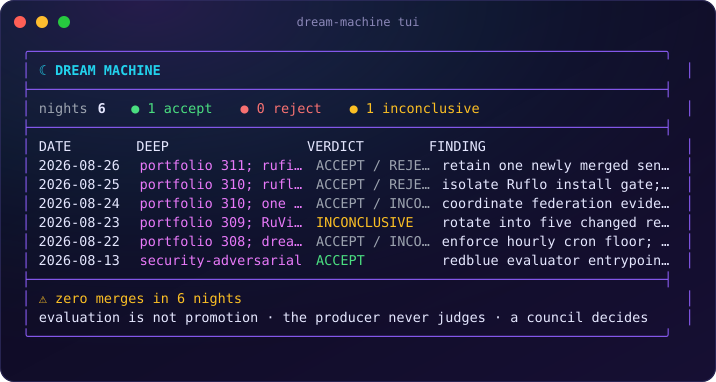

<div align="center">


# ☾ Dream Machine — Council Edition

**A config-driven engine for nightly, cloud-scheduled, evidence-gated repository evolution — where three model families, not a human, decide the merge.**

[](https://github.com/arielagor/dream-machine/actions/workflows/ci.yml)
[](https://github.com/arielagor/dream-machine/actions/workflows/codeql.yml)
[](https://www.npmjs.com/package/dream-machine)
[](LICENSE)
[](https://ruvnet.github.io/dream-machine/)

**[ADR-0003 — why a council replaced the human](docs/adrs/ADR-0003-council-of-model-families-merge-gate.md)** · **[Council log](docs/dream-cycle/COUNCIL.md)** · **[ADR-0001](docs/adrs/ADR-0001-dream-machine-engine.md)** · **[Upstream](https://github.com/ruvnet/dream-machine)**

</div>

> Freeze the model. Evolve the harness. **Evaluation is not promotion** — the
> session that writes a candidate never merges it. In this fork the one who does
> is not a human: it is a council of Claude, Gemini and Grok, and two of the
> three carry it.

```bash
npx dream-machine init --repo owner/name --out dream.config.json
npx dream-machine compile dream.config.json --out PROMPT.md
```

---

## What it is

The Dream Machine turns *"run one research-and-evolution cycle against a
repository every night"* into a **config-compiled engine** instead of a
hand-maintained megaprompt. It wakes up in an isolated cloud session, forms one
falsifiable hypothesis, measures it against the repo's real evaluators, and
writes down what it learned — whether or not the answer was the one it hoped
for.

It is the generalization of two routines already running nightly against
[`ruvnet/ruflo`](https://github.com/ruvnet/ruflo) and
[`ruvnet/metaharness`](https://github.com/ruvnet/metaharness). Both are ~800-line
prompts running the same 26-step pipeline; they differ only in a small,
well-defined per-repo delta. The Dream Machine factors the shared spine into an
engine and the differences into a `dream.config`.

## The nightly pipeline

<div align="center"><a href="https://ruvnet.github.io/dream-machine/#pipeline" title="See it animate on the live site"></a></div>

```
ledger → research → frozen hypothesis → concrete candidate → baseline
  → evaluation → adversarial critique → bounded Darwin evolution
  → flywheel evidence → witness → issue → draft PR → durable ledger row
```

Every night ends in exactly one verdict — **`ACCEPT`**, **`REJECT`**, or
**`INCONCLUSIVE`** — never a fourth, never silence. A rejected hypothesis with a
clean measurement is a *successful* night. The system optimizes for shrinking
tomorrow's search space, not for producing PRs.

## Install & CLI

```bash
npm i -g dream-machine       # or use npx

dream-machine init --repo owner/name --out dream.config.json   # scaffold a config
dream-machine compile dream.config.json --out PROMPT.md        # config → routine prompt
dream-machine schedule dream.config.json --out routine.json    # cloud /schedule body
dream-machine council review --pr 42 --repo owner/name         # convene the merge council
dream-machine ledger verify  --path docs/dream-cycle/LEDGER.md # structural checks
dream-machine ledger signals --path docs/dream-cycle/LEDGER.md # STEP 1.1 learning signals
dream-machine witness stamp  report.md <commit>                # provenance stamp
dream-machine witness verify report.md <commit> <witness>      # 5-step verify
dream-machine tui --path docs/dream-cycle/LEDGER.md            # the dashboard, below
```

### The TUI

<div align="center"></div>

### The management console

A browser dashboard renders the ledger as recent nights, verdict distribution,
and per-night evidence — the same data the TUI shows.

<div align="center"><a href="https://ruvnet.github.io/dream-machine/dashboard.html" title="Open the live management dashboard"></a></div>

## Schedule it — nightly, autonomous, always improving

The Dream Machine is built to run itself on a schedule. In **Claude Code**, the
built-in **`/schedule`** command creates a cloud routine that runs the pipeline
against your repo every night — autonomous research, evaluation, and
improvement that compounds while you sleep.

**1 — generate the routine body from your config:**

```bash
npx dream-machine schedule dream.config.json --env <your-cloud-env-id> --out routine.json
```

**2 — create the routine.** In Claude Code, type `/schedule`, choose a nightly
cron (e.g. `0 9 * * *` UTC) and your target repo, and paste the routine body
from `routine.json` — or, better, paste the tiny **self-hosting prompt** below.

**The prompt to paste into `/schedule` (recommended).** Rather than freeze a full
prompt, point the routine at a bootstrap that compiles tonight's instructions
from your committed `dream.config.json`, so the schedule can never drift from the
repo. This is the exact prompt that runs against this repository every night —
just change the repo slug:

```text
You are the Dream Machine nightly runner for ruvnet/dream-machine, checked out fresh on main.

STEP A — build the engine (a fresh checkout has no dist/):
  npm ci && npm run build || true          # a wasm/NAPI failure is a recorded degradation, not a stop

STEP B — compile tonight's instructions from the committed config:
  npx dream-machine compile dream.config.json --out /tmp/tonight.md
  cat /tmp/tonight.md

STEP C — follow /tmp/tonight.md EXACTLY: the full 26-step pipeline
  (ledger → research → frozen hypothesis → candidate → baseline → evaluation →
   adversarial critique → bounded Darwin → evidence → witness → issue → DRAFT PR → ledger row).

Invariants: end in exactly one of ACCEPT | REJECT | INCONCLUSIVE (INCONCLUSIVE
with LLM_EVAL=blocked when there's no API key is a legitimate, successful night).
Evaluation is not promotion — NEVER merge your own candidate, NEVER self-promote.
The council gate reviews your DRAFT PR afterwards and decides; write the PR body
for that reader. Publish a public gist + a labeled issue + a DRAFT PR, and append
exactly one row to docs/dream-cycle/LEDGER.md every run. Never weaken a test;
never force-push.
```

> Prefer to keep the whole prompt inline instead of the bootstrap?
> `npx dream-machine compile dream.config.json` prints the full 26-step routine —
> paste that into `/schedule` directly.

**What each night does** — research SOTA for tonight's rotation surface → freeze a
falsifiable hypothesis → build a concrete candidate → evaluate parent vs.
candidate on your real benchmarks → adversarial critique + reward-hack check →
bounded Darwin evolution → witnessed evidence → gist + issue + **draft** PR → one
ledger row. Win, lose, or draw, it records what it learned so tomorrow's search
space is smaller. **This repository runs exactly this loop on itself** (cron
`0 9 * * *`) — browse its
[dream-cycle issues](https://github.com/ruvnet/dream-machine/issues?q=label%3Adream-cycle),
gists, and draft PRs to see it in action.

> No `dream.config`? `npx dream-machine init --repo owner/name` scaffolds one.
> A night with no API key still runs — it reports `LLM_EVAL=blocked`, an honest
> `INCONCLUSIVE`, rather than faking a result.

### Or: the optional GitHub Actions "dream" (no cloud agent needed)

Prefer to stay entirely inside GitHub? [`.github/workflows/dream-nightly.yml`](.github/workflows/dream-nightly.yml)
runs the **research + hypothesis** half of the pipeline from a plain CI runner
using an [OpenRouter](https://openrouter.ai) model, files a witnessed
`dream-cycle` research issue, and opens a draft PR that appends one ledger row.

```yaml
# add repo secret OPENROUTER_API_KEY (+ optional var OPENROUTER_MODEL),
# then uncomment the schedule in dream-nightly.yml:
schedule:
  - cron: '0 9 * * *'
```

Honest scope: candidate evaluation, bounded Darwin, and the promotion gate need
the agentic `/schedule` session, so this CI path is **research-only** — every
night is an `INCONCLUSIVE` research night, and with no key it degrades to
`LLM_EVAL=blocked` rather than fabricating a finding. It's disabled by default
and also runs on demand via **Run workflow** (with a dry-run option).

## What it composes (never reimplements)

The heavy stages delegate to the ruvnet stack as **optional, config-selected
backends** — a night without any of them is a *degraded* night, not a failed one.

| Capability | Package | Used for |
|---|---|---|
| Promotion gate + receipts + replay | [`@metaharness/flywheel`](https://www.npmjs.com/package/@metaharness/flywheel) | evidence retention + promotion gate |
| Bounded evolution | [`@metaharness/darwin`](https://www.npmjs.com/package/@metaharness/darwin) | the fenced Darwin stage |
| Adversarial red/blue | [`@metaharness/redblue`](https://www.npmjs.com/package/@metaharness/redblue) | adversarial critic + reward-hack scan |
| Security scan / genome / audit | [`metaharness`](https://www.npmjs.com/package/metaharness) CLI | security review + discovery |
| Vector memory over prior nights | [`@ruvector/wasm`](https://www.npmjs.com/package/@ruvector/wasm) · [`@ruvector/rvf-wasm`](https://www.npmjs.com/package/@ruvector/rvf-wasm) | optional semantic recall (RVF container) |

## Packages

| Package | What it does |
|---|---|
| [`dream-machine`](packages/cli) | the CLI (`init/compile/schedule/ledger/witness/tui`) + TUI |
| [`@dream-machine/compile`](packages/compile) | `dream.config` → the full routine prompt (deterministic) |
| [`@dream-machine/ledger`](packages/ledger) | the 10-column `LEDGER.md` toolkit + learning signals |
| [`@dream-machine/witness`](packages/witness) | `sha256(sha256(report) + commit)` stamp / verify |
| [`@dream-machine/schedule`](packages/schedule) | the cloud `/schedule` routine body emitter |
| [`@dream-machine/memory`](packages/memory) | optional ruvector/RVF semantic memory, flat-file fallback |
| [`@dream-machine/council`](packages/council) | the three-family merge council: families, prompts, tally, witness |

## The merge gate — a council, not a person

Upstream, a merge needed a human to attach an `automerge-safe` label, and any PR
touching a gate, threshold, workflow, or dependency manifest was human-review-only
regardless. Here that job belongs to three model families from three providers.

```
PR opened  →  authorship + kill-switch check  →  wait for required checks
           →  round 1: three independent votes, blind to each other
           →  round 2: each family reads the others' votes and cross-examines
           →  tally (plain arithmetic, in code)  →  merge or block
```

Two of three `MERGE` votes merge it. Flat, on every path — including changes to
the council's own code. Nothing is human-gated; see
[ADR-0003](docs/adrs/ADR-0003-council-of-model-families-merge-gate.md) for why
that was chosen over a tiered quorum, and what it costs.

Run it by hand against any PR:

```bash
dream-machine council review  --pr 42 --repo owner/name          # convene and (if it merges) log
dream-machine council review  --pr 42 --json --dry-run           # full transcript, decide nothing
```

The exit code *is* the verdict: `0` merge, `1` block, `2` not eligible. Anything
else means the CLI itself failed, which the workflow also treats as a block.

**Check `familiesUsed` in the JSON.** Fewer than three means the panel degraded,
and a degraded panel is not the cross-provider check this exists to provide — so
it blocks.

### Setup

Three repository secrets, and the loop runs without you:

| Secret | For | Cost |
|---|---|---|
| `CLAUDE_CODE_OAUTH_TOKEN` | Claude, via the `claude` CLI | your Claude subscription — run `claude setup-token` once |
| `GEMINI_API_KEY` | Gemini | metered, cents per PR |
| `XAI_API_KEY` | Grok | metered, cents per PR |

Claude deliberately goes through the CLI rather than the Messages API: it keeps
the vote on the subscription and keeps this workspace free of runtime
dependencies. A missing secret does not shrink the panel quietly — it makes that
family unreachable, which blocks the merge.

Repository variable `COUNCIL_ENABLED=false` switches the gate off entirely. It is
an off switch, not a review step.

> The nightly research workflow's `schedule:` is still commented out, as
> upstream. The council gate is live on PR events regardless; uncommenting that
> cron is what starts the fully autonomous nightly loop.

## Safety

This fork has no human in the merge path, so its guarantees are enforced in code
and CI rather than by a reviewer (see [SECURITY.md](SECURITY.md) and
[ADR-0003](docs/adrs/ADR-0003-council-of-model-families-merge-gate.md)):

- **The producer never judges.** The nightly session still never merges its own
  candidate and opens *draft* PRs only. A separate process, with no authoring
  context, casts the votes — that separation is what makes a majority mean
  anything, and it is the half of the upstream guarantee that survives.
- **A degraded panel never merges.** If any family is unreachable, the vote is
  void. This is the rule that matters most: the families that *do* answer still
  return confident, well-formed votes, so without it a provider outage silently
  turns a three-family gate into a one-family gate that still reads as unanimous.
  Unparseable output becomes `ABSTAIN`, which counts as not-a-merge.
- **The count is code, not a model.** `tally()` is plain arithmetic. A
  synthesiser deciding "what the panel meant" would collapse the gate back into
  a single model's opinion.
- **Proven in CI, not asserted.** A `council-fails-closed` job runs the real gate
  with every model credential absent and fails if it returns `MERGE`.
- **External PRs are not council-judged.** The gate runs on
  `pull_request_target` in a public repo, so only PRs whose head branch is in
  this repository are voted on, and the workflow checks out `base.sha` — never
  the PR head — so untrusted code never runs beside the secrets.
- **Optional deps stay optional** (ADR-150) — a CI job proves the engine builds
  and tests with the ruvector wasm backends absent.
- **Witnessed provenance** — every report *and every merge verdict* is bound to
  its commit by a reproducible double-sha256 anyone can re-derive.

## Prior art

The upstream design answers a known failure mode of open-loop autonomous research
agents (Sakana AI's "The AI Scientist" reward-hacking incident; AutoGPT/BabyAGI-era
loops with ~5% follow-through). The promotion gate, adversarial critic,
reward-hack check, and human-only merge boundary exist precisely because of them.

Removing the human raises that stake rather than settling it, and this fork does
not pretend otherwise. What replaces the human is an adversarial panel drawn from
three providers, so a reward hack has to fool three different training lineages
at once instead of one tired reader — and a panel that cannot be fully assembled
declines rather than proceeds. Three models can still agree and be wrong
together. [ADR-0003](docs/adrs/ADR-0003-council-of-model-families-merge-gate.md)
states plainly what was gained and what was given up.

## License

MIT © [rUv](https://github.com/ruvnet). Council fork by
[arielagor](https://github.com/arielagor); upstream engine unchanged except where
[ADR-0003](docs/adrs/ADR-0003-council-of-model-families-merge-gate.md) says so.
